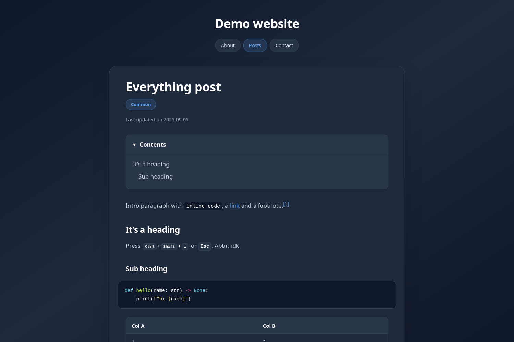
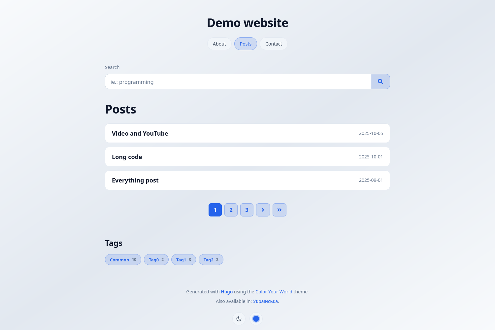
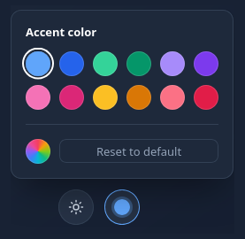
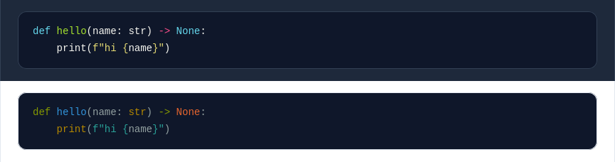

# Color Your World

[](https://gohugo.io/)
[](LICENSE)

A minimal, privacy-aware [Hugo](https://gohugo.io/) theme for personal sites and technical blogs: slate dark and light modes, content on rounded cards, and an accent color your visitors can pick themselves.

This is a fork of [Color Your World](https://gitlab.com/rmaguiar/hugo-theme-color-your-world) by Raphael Aguiar, with a new design, bug fixes and video support. See [Upgrading from the original theme](#upgrading-from-the-original-theme) if you're switching.





## Contents

* [Features](#features)
* [Requirements](#requirements)
* [Installation](#installation)
* [Quick start](#quick-start)
* [Appearance](#appearance)
* [Writing content](#writing-content)
* [Search](#search)
* [Shortcodes](#shortcodes)
* [Customization](#customization)
* [Configuration reference](#configuration-reference)
* [Upgrading from the original theme](#upgrading-from-the-original-theme)
* [Development](#development)
* [Credits](#credits)

## Features

* Dark and light modes, following the system setting or a site default, switchable by visitors;
* An accent color picker with your own presets (plus any custom color), remembered per mode;
* System fonts, so no web fonts are downloaded;
* Wide content column, so ~90 columns of code fit without scrolling on desktop;
* Syntax highlighting with high contrast (WCAG AA) Monokai and Solarized styles;
* Videos attached to posts, with Markdown or a shortcode;
* YouTube embeds that load nothing from YouTube until the visitor presses play;
* Search via [Pagefind](https://pagefind.app/);
* Responsive images (resized and converted to WebP at build time) and lazy loading;
* Math via [KaTeX](https://katex.org/);
* Social links (centralized and decentralized platforms) and a contact form (via [Formspree](https://formspree.io/));
* Open Graph, Twitter Cards and Schema.org meta tags, plus `rel="me"` links;
* Multilingual, with English, German, Portuguese and Ukrainian translations;
* Keyboard friendly, and works without JavaScript (except for search, KaTeX and the color picker);
* Privacy-aware: no Google Analytics, Google Fonts, Disqus, etc.

## Requirements

* Hugo **Extended**, version **0.141.0** or newer (tested with 0.152.2);
* Optional: [Pagefind](https://pagefind.app/) for search.

## Installation

As a Git submodule, from your site's folder:

```bash
git submodule add https://github.com/sprytnyk/hugo-theme-color-your-world.git themes/color-your-world
```

Or as a plain clone:

```bash
git clone https://github.com/sprytnyk/hugo-theme-color-your-world.git themes/color-your-world
```

Then set `theme = "color-your-world"` in your site config.

## Quick start

A minimal `hugo.toml`:

```toml
baseURL = "https://example.org/"
languageCode = "en"
title = "Jane Doe"
theme = "color-your-world"

[pagination]
  pagerSize = 10

# Required for the theme's syntax highlighting styles
[markup.highlight]
  noClasses = false

[menus]
  [[menus.main]]
    name = "About"
    url = "/"
    weight = 1
  [[menus.main]]
    name = "Posts"
    url = "posts/"
    weight = 2

[params]
  description = "Jane Doe's personal website"
  author = "Jane Doe"
  footerText = [ "Built with [Hugo](https://gohugo.io)." ]

  [params.style]
    isDark = true
```

Posts go in `content/posts/` (or whatever is set as `mainSections`). The home page lists them, unless `content/_index.md` has content of its own, in which case it shows that instead (handy for an "About me" home page).

Build with `--minify` for the smallest output:

```bash
hugo --minify
```

## Appearance

### Dark and light modes

```toml
[params.style]
  # Use dark mode by default (the default is false)
  isDark = true

  # Ignore the system setting (prefers-color-scheme) and always start
  # with the default mode above (the default is false)
  ignoreSystemSettings = false
```

The mode is picked in this order: the visitor's choice (button in the footer), then the system setting, then `isDark`.

Both palettes are in `assets/scss/colors/variables.scss`, based on [Tailwind's](https://tailwindcss.com/docs/colors) *slate* colors. To change them, copy that file to the same path in your site and edit it.

### Accent color

The accent color is used for links, buttons, tags and highlights. Visitors can change it from the footer:



```toml
[params.style]
  # Default accent for each mode
  darkAccent  = "#60a5fa" # Default is "#60a5fa"
  lightAccent = "#2563eb" # Default is "#2563eb"

  # Colors offered in the menu, after the two defaults
  # Any other color can still be picked with the rainbow swatch
  presets = [ "#34d399", "#059669", "#a78bfa", "#7c3aed", "#f472b6", "#db2777", "#fbbf24", "#d97706", "#fb7185", "#e11d48" ]
```

Use 6-digit hex colors (`#rrggbb`). The choice is saved in the visitor's browser, separately for each mode.

### Fonts

The theme uses the system font stack (`system-ui` and friends), so no font files are downloaded.

To self-host fonts instead:

1. Put the font files in your site's `assets/fonts/` (they will be preloaded). [google-webfonts-helper](https://gwfh.mranftl.com/fonts) can generate them.
2. Put the `@font-face` rules in `assets/scss/fonts/font-face.scss`.
3. Copy `assets/scss/fonts/variables.scss` from the theme and change the font names.

### Syntax highlighting



Code uses Monokai in dark mode and Solarized Dark in light mode, both on a slate background, based on the [pygments-high-contrast-stylesheets](https://github.com/mpchadwick/pygments-high-contrast-stylesheets) (WCAG AA passing). Tabs are 4 columns wide.

It needs `noClasses = false` under `[markup.highlight]` in your config. The styles are in `assets/scss/colors/chroma/`, as `dark.scss` and `light.scss`.

To use Hugo's own inline styles instead, leave `noClasses` out and set:

```toml
[params.style]
  useCustomChroma = false
```

## Writing content

### Front matter

Besides Hugo's own (`title`, `date`, `lastmod`, `tags`, `categories`, `draft`, ...):

| Param | Description |
|---|---|
| `description` | Used in meta tags and the RSS feed. |
| `cover`, `coverAlt` | Cover image (page resource) shown under the title, and used for Open Graph, Twitter Cards and Schema.org. |
| `toc` | `true` shows a table of contents. |
| `katex` or `math` | `true` loads KaTeX on the page. |
| `katexExtensions` | KaTeX extensions to load: `[ mhchem, copy-tex ]`. |
| `mainTitle` | Replaces the `<title>` tag, if it should differ from the `<h1>`. |
| `disableTitleSeparator` | `true` leaves the site title out of the `<title>` tag. |
| `sitemapExclude` | `true` leaves the page out of the sitemap and search. |
| `noindex` | `true` asks search engines not to index the page, and leaves it out of search. |
| `imgPath`, `videoPath` | Folder of the page bundle to look for images and videos in. |
| `markupImgClass` | Class for Markdown images: `border` or `borderless`. |

The `archetypes` folder has templates for posts (`default`), the home page (`home`), math posts (`katex`), standalone pages (`page`) and the search page (`search`):

```bash
hugo new --kind katex posts/my-post.md
```

### Images

Images are responsive: images in the page bundle are resized to 1280, 960 and 640 pixels wide (when they're bigger than that), with a WebP version of each, and lazy loaded. That applies to Markdown images and the `img` and `figure` shortcodes.

Cover images are also cropped for Open Graph (1200×630) and Twitter Cards (1280×640).

In dark mode, images are slightly dimmed (except SVG).

See [Image processing](#image-processing) to change the sizes.

### Videos

Attach a video to a post (page bundle) and add it with plain Markdown, on its own line:

```markdown

```

Files with the same name are picked up automatically:

* `clip.webm` (or `.mp4`, `.ogv`, `.mov`, `.m4v`) as an extra format, smallest file first;
* `clip.jpg` (or `.jpeg`, `.png`, `.webp`, `.avif`) as the poster;
* `clip.vtt` as captions.

For more options, see the [`video` shortcode](#video). For YouTube, see the [`youtube` shortcode](#youtube).

### Math

With `katex: true` (or `math: true`) in the front matter, or in `[params]` for the whole site, math is rendered with KaTeX. Use `$...$` or `\(...\)` inline, and `$$...$$` or `\[...\]` for blocks.

Markdown may change characters inside expressions (like `_` or `\\`). Wrap them in the `katex` shortcode to keep them as they are:

```markdown

$$x_{1,2} = \frac{-b \pm \sqrt{b^2 - 4ac}}{2a}$$

```

## Search

Search runs in the browser with [Pagefind](https://pagefind.app/), which indexes the built site.

1. Create the search page, `content/search.md`:

   ```bash
   hugo new --kind search search.md
   ```

2. Enable the search form (shown above the post list):

   ```toml
   [params.search]
     enable = true
   ```

3. Build the site, then the index:

   ```bash
   hugo --minify
   npx -y pagefind --site public
   ```

   To try it locally, serve the `public` folder (for example with `npx -y pagefind --site public --serve`), since `hugo server` doesn't run Pagefind.

Only posts and pages are indexed, not lists. Pages with `sitemapExclude` or `noindex` are left out.

## Shortcodes

### Video

```markdown




```

| Param | Description |
|---|---|
| `src` (or 1st) | File in the page bundle (also looked up in `videoPath`, `video` by default), or a URL. |
| `caption` (or 2nd) | Caption, Markdown allowed. |
| `poster` | Poster image (page resource or URL). Defaults to an image with the video's name. |
| `title` | Accessible name, defaults to the caption. |
| `autoplay` | Plays muted, in loop and without controls, like a GIF. |
| `loop`, `muted`, `controls` | Override the defaults (controls are on, unless `autoplay`). |
| `class` | Extra classes for the `<figure>`. |

### YouTube

The theme replaces Hugo's built-in `youtube` shortcode with a lighter embed: the video's thumbnail and title with a play button. The player is only loaded when it's clicked, and without JavaScript it's a link to the video.

```markdown


```

| Param | Description |
|---|---|
| `id` (or 1st) | Video ID. |
| `title` | Shown over the thumbnail. Defaults to the video's title on YouTube. |
| `start`, `end` | Start and end time, in seconds. |
| `caption` | Caption, Markdown allowed. |
| `class` | Extra classes for the `<figure>`. |

The thumbnail and title are downloaded **when the site is built** (and cached by Hugo), and served from your site. Visitors don't connect to YouTube until they press play. If they can't be downloaded, the build still works, with a placeholder instead.

It follows Hugo's `privacy.youtube` config:

```toml
[privacy.youtube]
  # Play from youtube-nocookie.com
  privacyEnhanced = true
  # Only render the link
  disable = false
```

### Social

Links to your profiles, as a grid of cards. The same profiles are used for the `rel="me"` links and Schema.org data.

```markdown

```

Centralized platforms take a username, and an optional label. Decentralized ones (with instances) take a full URL and a label, and can have several accounts:

```toml
[params.social.centralized]
  github        = [ "<username>" ]
  gitlab        = [ "<username>" ]
  linkedin      = [ "<username>" ]
  x             = [ "<username>", "@birb" ]
  # Also: facebook, flickr, instagram, keybase, medium, reddit, snapchat,
  # soundcloud, stackOverflow, strava, telegram, twitch, vimeo,
  # whatsapp (<number>), xing, youtube
  # The key matters: it's used to find the platform in data/social.json

[params.social.decentralized]
  [params.social.decentralized.mastodon]
    1 = [ "https://mastodon.social/@<username>", "mastodon.social" ]
    2 = [ "https://fosstodon.org/@<username>", "fosstodon.org" ]
  [params.social.decentralized.bsky]
    1 = [ "https://bsky.app/profile/<username>.bsky.social", "bsky.social" ]
  # Also: element, funkwhale, matrix, peertube, pixelfed
  # The keys inside (1, 2...) don't matter
```

```toml
[params.style]
  # Cards fill the row (flexbox) instead of having equal widths (grid)
  socialIsFlex = false
```

### Contact form

A contact form, sent via [Formspree](https://formspree.io/):

```markdown

```

```toml
[params.contact]
  formspreeFormId = "example"

  # Browser autocomplete (the default is false)
  autoComplete = false

  # Minimum length of the message (the default is 140)
  messageMinLength = 140

  # Subjects to choose from. With a single one, there's no dropdown.
  # Without it, the subject is a text field (keep it as an array)
  subject = [ 'Just saying "hi"', "I know what you did last winter" ]

  [params.contact.placeholder]
    name    = "Jane Doe"
    email   = "janedoe@example.com"
    subject = 'Just saying "hi"' # Only used for the text field
    message = "Hello there!"
```

### Images

`img` and `figure` (the latter with a caption) work like Markdown images, with a few more options:

```markdown



```

`class` can be `border` or `borderless`, and `resize=false` skips the image processing.

### Others

| Shortcode | Example | Output |
|---|---|---|
| `kbd` | `` | Keyboard keys: <kbd>Ctrl</kbd>+<kbd>Shift</kbd>+<kbd>i</kbd> |
| `abbr` | `` | An abbreviation with its meaning on hover. |
| `gifoid` | `` | `video/cat.mp4` and `.webm` as a GIF-like video (see also `video` with `autoplay`). |
| `katex` | `...` | Keeps math expressions as they are (see [Math](#math)). |

## Customization

Files in your site override the theme's, so you can copy any file from the theme and change it. These are meant for it:

| File in your site | Purpose |
|---|---|
| `assets/scss/custom.scss` (or `static/css/custom.css`) | Extra CSS, added to the end of the theme's stylesheet. |
| `assets/scss/colors/variables.scss` | Dark and light palettes. |
| `assets/scss/fonts/variables.scss`, `font-face.scss` | Fonts (see [Fonts](#fonts)). |
| `assets/scss/rich-content.scss` | Styles for embedded content (tweets, etc). |
| `layouts/partials/custom/head-append.html` | Added to the `<head>`: favicons, scripts, etc. |
| `layouts/partials/custom/site-title.html` | Replaces the site title in the header (with a logo, for example). |
| `layouts/partials/custom/footer-text.html` | Replaces the `footerText` param. |
| `i18n/<lang>.toml` | Changes or adds translations. |

For a basic 404 page:

```toml
[params.notFound]
  title       = "Page not found"
  description = "This page was not found."
  paragraph   = "Nothing to see here."
```

## Configuration reference

All theme params, with their defaults or an example:

```toml
# Used only in the RSS feed
copyright = "Copyright © 2025, Jane Doe; All rights reserved."

[params]
  description = "Jane Doe's personal website"

  # Author, used in meta tags, Schema.org and the RSS feed
  author     = "Jane Doe"
  authorDesc = "Software Engineer"

  # Each value becomes a paragraph (Markdown and emoji allowed)
  footerText = [ "Built with [Hugo](https://gohugo.io)." ]

  # Site cover for Open Graph, Twitter Cards and Schema.org, from
  # the "assets" folder. Used when a page has no cover of its own
  cover    = "img/cover.jpg"
  coverAlt = "Description of the cover."

  # Shows a message in the footer when JavaScript is disabled (false)
  hasNoscriptNotice = true

  # Default folders for images and videos in page bundles (no default
  # for images, "video" for videos). Can also be set per page
  imgPath   = "img"
  videoPath = "video"

  # Class for Markdown images: border or borderless (no default)
  # Can also be set per page
  markupImgClass = "borderless"

  # Separator between the page and site titles in the <title> tag
  # Without it, only the page title is used
  titleSeparator = "|"

  # Load KaTeX on every page (false)
  katex = false
  katexExtensions = [ "mhchem", "copy-tex" ]

  [params.search]
    enable      = true             # Show the search form (false)
    maxResults  = 30               # 30
    pageResults = 10               # Results per page (10)
    minLength   = 3                # Search field limits (3 and 32)
    maxLength   = 32
    placeholder = "e.g.: programming"

  [params.style]
    isDark               = true    # false
    ignoreSystemSettings = false   # false
    darkAccent           = "#60a5fa"
    lightAccent          = "#2563eb"
    presets              = [ "#34d399", "#a78bfa", "#f472b6" ]

    useCustomChroma             = true   # true
    hasIconAsFootnoteReturnLink = true   # Icon instead of text (false)
    hideAnchors                 = true   # Heading links only on hover (false)
    socialIsFlex                = false  # false

    # Transition when changing modes (".3s ease")
    changeTransition = ".3s ease"
```

### Image processing

```toml
[params.imageProcessing]
  # Resize images (Markdown, "img" and "figure")
  autoResize = true

  # Format for TIFF files, which browsers don't support
  fallbackOptions = "jpeg"

  # Sizes for Open Graph and Twitter Card images
  openGraphFillOptions = "1200x630"
  twitterFillOptions   = "1280x640"

  # Extra formats, along JPEG/PNG
  [[params.imageProcessing.extraFormats]]
    formatOptions = "webp"
    mediaType     = "image/webp"
    minVersion    = "0.83"

  # Sizes, in descending order. The smallest is the default image
  [[params.imageProcessing.sizes]]
    resizeOptions = "1280x"
    descriptor    = "1280w"
    minWidth      = 1280

  [[params.imageProcessing.sizes]]
    resizeOptions = "960x"
    descriptor    = "960w"
    minWidth      = 960

  [[params.imageProcessing.sizes]]
    resizeOptions = "640x q90"
    descriptor    = "640w"
    minWidth      = 640
```

## Upgrading from the original theme

Sites made for the original theme work as they are, apart from these changes:

* **Hugo 0.141.0 or newer** is required. Newer Hugo versions also need some site config changes:
  * `paginate = 10` is now `[pagination]` with `pagerSize = 10` (it's an error since Hugo 0.128);
  * `[privacy.twitter]` and `[services.twitter]` are now `[privacy.x]` and `[services.x]`.
* **New design**, with system fonts instead of Oswald and Open Sans.
* **New default accent colors** (`#60a5fa` and `#2563eb`). Accents set in your config still apply.
* If you override `assets/scss/colors/variables.scss` or the font files, start again from the new files, as the variables changed.
* The color picker is now a menu with your presets, instead of the browser's color input.
* The `youtube` shortcode is replaced (same params as Hugo's, plus `caption`).

The fixes and features from this fork are in the [commit history](https://github.com/sprytnyk/hugo-theme-color-your-world/commits/master).

## Development

To work on the theme, point any Hugo site at your copy:

```bash
hugo server --themesDir /path/to/parent/folder --theme hugo-theme-color-your-world
```

## Credits

* [Raphael Aguiar](https://gitlab.com/rmaguiar), who made the original [Color Your World](https://gitlab.com/rmaguiar/hugo-theme-color-your-world). If it's useful to you, consider [buying him a coffee](https://ko-fi.com/rmaguiar);
* [Font Awesome](https://fontawesome.com/), [Fork Awesome](https://forkaweso.me/) and [Lucide](https://lucide.dev/) for the icons;
* [@nickpunt](https://gist.github.com/nickpunt) and [@regpaq](https://gist.github.com/regpaq) for the [dark/light mode switcher](https://gist.github.com/regpaq/04c67e8aceecbf0fd819945835412d1f) idea;
* Glenn McComb and [his article](https://glennmccomb.com/articles/how-to-build-custom-hugo-pagination/) about custom pagination with Hugo;
* [Pagefind](https://pagefind.app/) and [KaTeX](https://katex.org/);
* [@britonad](https://gitlab.com/britonad) for the Ukrainian translation, and [@moanos](https://gitlab.com/moanos) for the German one;
* Hugo and [its community](https://discourse.gohugo.io/).

Released under the [MIT License](LICENSE).
