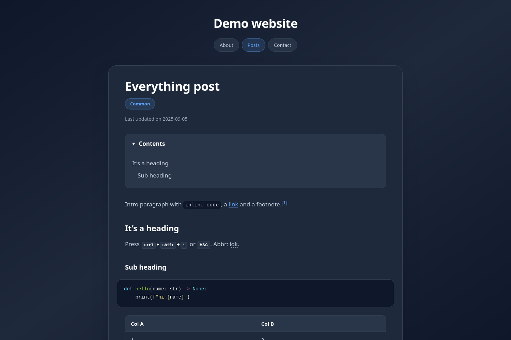
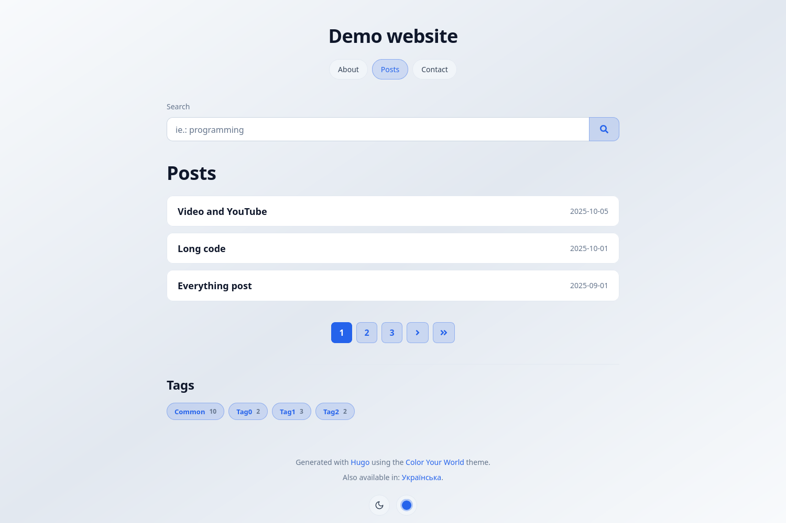
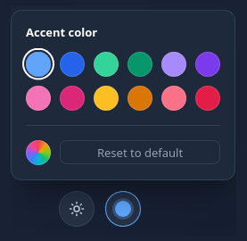
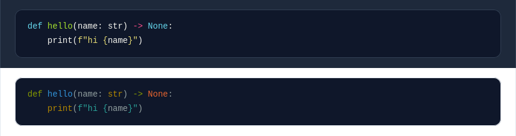

# Color Your World

[](https://gohugo.io/)
[](LICENSE)

A minimal, privacy-aware [Hugo](https://gohugo.io/) theme for personal sites and technical blogs. It has slate dark and light modes, puts content on rounded cards, and lets visitors pick their own accent color.

This is a fork of [Color Your World](https://gitlab.com/rmaguiar/hugo-theme-color-your-world) by Raphael Aguiar, with a new design, bug fixes and video support. If you're switching from the original, see [Upgrading from the original theme](#upgrading-from-the-original-theme).





## Contents

* [Features](#features)
* [Requirements](#requirements)
* [Installation](#installation)
* [Quick start](#quick-start)
* [Appearance](#appearance)
* [Writing content](#writing-content)
* [Search](#search)
* [Comments](#comments)
* [Shortcodes](#shortcodes)
* [Customization](#customization)
* [Configuration reference](#configuration-reference)
* [Upgrading from the original theme](#upgrading-from-the-original-theme)
* [Development](#development)
* [Credits](#credits)

## Features

* Dark and light modes. The theme follows the system setting or a site default, and visitors can switch;
* An accent color picker with your own presets and any custom color, saved per mode;
* System fonts, so visitors download no web fonts;
* A wide content column, so about 90 columns of code fit on desktop without scrolling;
* Syntax highlighting in Monokai and Solarized styles that pass WCAG AA contrast;
* Videos in posts, with Markdown or a shortcode;
* YouTube embeds that load nothing from YouTube until the visitor presses play;
* Search via [Pagefind](https://pagefind.app/);
* Optional comments via [giscus](https://giscus.app/), stored in GitHub Discussions and drawn in the site's colors;
* Responsive images, resized and converted to WebP at build time, and lazy loading;
* Math via [KaTeX](https://katex.org/);
* Social links for centralized and decentralized platforms, and a contact form via [Formspree](https://formspree.io/);
* Open Graph, Twitter Cards and Schema.org meta tags, plus `rel="me"` links;
* Multilingual sites, with English, German, Portuguese and Ukrainian translations;
* Keyboard friendly. Everything works without JavaScript except search, comments, KaTeX and the color picker;
* No Google Analytics, Google Fonts or Disqus.

## Requirements

* Hugo Extended 0.141.0 or newer, tested up to 0.152.2;
* [Pagefind](https://pagefind.app/) for search, if you want it.

## Installation

To add the theme as a Git submodule, run this from your site's folder:

```bash
git submodule add https://github.com/sprytnyk/hugo-theme-color-your-world.git themes/color-your-world
```

Or clone it:

```bash
git clone https://github.com/sprytnyk/hugo-theme-color-your-world.git themes/color-your-world
```

Then set `theme = "color-your-world"` in your site config.

## Quick start

Here's a minimal `hugo.toml`:

```toml
baseURL = "https://example.org/"
languageCode = "en"
title = "Jane Doe"
theme = "color-your-world"

[pagination]
  pagerSize = 10

# Required for the theme's syntax highlighting styles
[markup.highlight]
  noClasses = false

[menus]
  [[menus.main]]
    name = "About"
    url = "/"
    weight = 1
  [[menus.main]]
    name = "Posts"
    url = "posts/"
    weight = 2

[params]
  description = "Jane Doe's personal website"
  author = "Jane Doe"
  footerText = [ "Built with [Hugo](https://gohugo.io)." ]

  [params.style]
    isDark = true
```

Put posts in `content/posts/`, or in the sections `mainSections` names. The home page lists them. If `content/_index.md` has content of its own, the home page shows that instead, which suits an "About me" home page.

Build with `--minify` for the smallest output:

```bash
hugo --minify
```

## Appearance

### Dark and light modes

```toml
[params.style]
  # Start in dark mode (default: false)
  isDark = true

  # Ignore the system setting (prefers-color-scheme) and always start
  # in the mode above (default: false)
  ignoreSystemSettings = false
```

The theme picks the mode in this order: the visitor's choice from the footer button, then the system setting, then `isDark`.

Both palettes are in `assets/scss/colors/variables.scss`, based on [Tailwind's](https://tailwindcss.com/docs/colors) *slate* colors. To change them, copy that file to the same path in your site and edit it.

### Accent color

Links, buttons, tags and highlights use the accent color. Visitors can change it from the footer:



```toml
[params.style]
  # Default accent for each mode
  darkAccent  = "#60a5fa" # Default is "#60a5fa"
  lightAccent = "#2563eb" # Default is "#2563eb"

  # Colors offered in the menu, after the two defaults
  # Visitors can still pick any other color with the rainbow swatch
  presets = [ "#34d399", "#059669", "#a78bfa", "#7c3aed", "#f472b6", "#db2777", "#fbbf24", "#d97706", "#fb7185", "#e11d48" ]
```

Use 6-digit hex colors, like `#2563eb`. The visitor's browser saves their choice, separately for each mode.

### Fonts

The theme uses the system font stack, starting with `system-ui`, so visitors download no font files.

To self-host fonts instead:

1. Put the font files in your site's `assets/fonts/`. The theme preloads them. [google-webfonts-helper](https://gwfh.mranftl.com/fonts) can generate them.
2. Put the `@font-face` rules in `assets/scss/fonts/font-face.scss`.
3. Copy `assets/scss/fonts/variables.scss` from the theme and change the font names.

### Syntax highlighting



Code uses Monokai in dark mode and Solarized Dark in light mode, both on a slate background. The colors come from [pygments-high-contrast-stylesheets](https://github.com/mpchadwick/pygments-high-contrast-stylesheets) and pass WCAG AA. Tabs are 4 columns wide.

This needs `noClasses = false` under `[markup.highlight]` in your config. The styles are `dark.scss` and `light.scss` in `assets/scss/colors/chroma/`.

To use Hugo's own inline styles instead, leave `noClasses` out and set:

```toml
[params.style]
  useCustomChroma = false
```

## Writing content

### Front matter

The theme reads these params on top of Hugo's own, like `title`, `date`, `lastmod`, `tags`, `categories` and `draft`:

| Param | Description |
|---|---|
| `description` | Goes into meta tags and the RSS feed. |
| `cover`, `coverAlt` | A cover image from the page bundle. It shows under the title and goes into Open Graph, Twitter Cards and Schema.org. |
| `toc` | `true` shows a table of contents. |
| `comments` | `false` hides the comments on a post, `true` shows them on any other page. See [Comments](#comments). |
| `katex` or `math` | `true` loads KaTeX on the page. |
| `katexExtensions` | KaTeX extensions to load: `[ mhchem, copy-tex ]`. |
| `mainTitle` | Text for the `<title>` tag, when it should differ from the `<h1>`. |
| `disableTitleSeparator` | `true` leaves the site title out of the `<title>` tag. |
| `sitemapExclude` | `true` leaves the page out of the sitemap and search. |
| `noindex` | `true` asks search engines not to index the page, and leaves it out of search. |
| `imgPath`, `videoPath` | Folder in the page bundle where the theme looks for images and videos before the bundle root. |
| `markupImgClass` | Class for Markdown images: `border` or `borderless`. |

The `archetypes` folder has templates: `default` for posts, `home` for the home page, `katex` for math posts, `page` for standalone pages and `search` for the search page. For example:

```bash
hugo new --kind katex posts/my-post.md
```

### Images

The theme resizes images from the page bundle to 1280, 960 and 640 pixels wide, when they're bigger than that, and adds a WebP version of each. Browsers load them lazily. This covers Markdown images and the `img` and `figure` shortcodes.

The theme also crops cover images to 1200×630 for Open Graph and 1280×640 for Twitter Cards.

Dark mode dims images to 90% brightness, except SVG.

To change the sizes, see [Image processing](#image-processing).

If a relative image isn't in the page bundle, the build warns with `can't find "photo.jpg" in the page bundle`, since the link would be broken.

### Videos

Put a video in the post's page bundle and add it with plain Markdown, on its own line:

```markdown

```

The theme also picks up files with the same name:

* `clip.webm`, `.mp4`, `.ogv`, `.mov` or `.m4v` as extra formats, smallest file first;
* `clip.jpg`, `.jpeg`, `.png`, `.webp` or `.avif` as the poster;
* `clip.vtt` as captions.

For more options, see the [`video` shortcode](#video). For YouTube, see the [`youtube` shortcode](#youtube).

### Math

Set `katex: true` or `math: true` in the front matter, or in `[params]` for the whole site, and KaTeX renders the math. Use `$...$` or `\(...\)` inline, and `$$...$$` or `\[...\]` for blocks.

Markdown may change characters such as `_` or `\\` inside expressions. Wrap them in the `katex` shortcode to keep them as they are:

```markdown

$$x_{1,2} = \frac{-b \pm \sqrt{b^2 - 4ac}}{2a}$$

```

## Search

Search runs in the browser with [Pagefind](https://pagefind.app/), which indexes the built site.

1. Create the search page, `content/search.md`:

   ```bash
   hugo new --kind search search.md
   ```

2. Turn on the search form, which shows above the post list:

   ```toml
   [params.search]
     enable = true
   ```

3. Build the site, then the index:

   ```bash
   hugo --minify
   npx -y pagefind --site public
   ```

   `hugo server` doesn't run Pagefind. To try search locally, serve the `public` folder, for example with `npx -y pagefind --site public --serve`.

Pagefind indexes posts and pages, not lists. It skips pages with `sitemapExclude` or `noindex`.

## Comments

Comments use [giscus](https://giscus.app/), which stores them in your repo's GitHub Discussions. Visitors sign in with GitHub to comment.

1. Make the repo public, enable Discussions and install the [giscus app](https://github.com/apps/giscus) on it.
2. Fill in the repo and category on [giscus.app](https://giscus.app/), and copy `data-repo-id` and `data-category-id` from the snippet it makes.
3. Add them to your config:

   ```toml
   [params.giscus]
     repo       = "owner/repo"
     repoId     = "R_..."
     category   = "Announcements"
     categoryId = "DIC_..."
   ```

Without `repo`, `repoId` and `categoryId`, the theme adds nothing to the site.

The theme shows comments on posts, the pages in `mainSections`, in a card under the post. Set `comments: false` in the front matter to hide them on a post, or `comments: true` to show them on any other page.

The theme builds two CSS files from your palette and default accents: `/css/giscus-dark.css` and `/css/giscus-light.css`. They sit on top of giscus's high contrast themes, and the comments switch between them with the mode. The files take the accent from a CSS variable, `--cyw-accent`. The theme sets it to the visitor's accent, so the comments follow any color they pick, custom ones included.

To change the colors, copy `assets/scss/giscus.scss` to your site and build every accent shade from `--cyw-accent`. Or point `darkTheme` and `lightTheme` to other files. The theme doesn't pass the accent to files of your own.

giscus loads these files from its own domain, so your server has to send an `Access-Control-Allow-Origin` header with them. GitHub Pages sends it by default. On Netlify and Cloudflare Pages, add a `static/_headers` file:

```
/css/giscus-dark.css
  Access-Control-Allow-Origin: *
/css/giscus-light.css
  Access-Control-Allow-Origin: *
```

On other hosts, look up how to add a response header in their docs. For `hugo server`, add this to your config:

```toml
[server]
  [[server.headers]]
    for = "/css/giscus-*"
    [server.headers.values]
      Access-Control-Allow-Origin = "*"
```

Without the header, the browser blocks the files.

giscus loads only when the visitor scrolls near the comments. Set `loading = "eager"` to load it with the page. Without JavaScript there are no comments. Loading giscus connects the visitor's browser to giscus.app.

All the options, with their defaults:

```toml
[params.giscus]
  repo       = "owner/repo"
  repoId     = "R_..."
  category   = "Announcements"
  categoryId = "DIC_..."

  mapping          = "pathname" # How giscus finds a page's discussion: pathname, url, title or og:title
  strict           = false      # Match titles exactly, by hash
  reactionsEnabled = true       # Reactions to the post
  emitMetadata     = false      # Send discussion metadata to the page
  inputPosition    = "bottom"   # Comment box at the top or bottom
  lang             = ""         # Defaults to the page's language
  loading          = "lazy"     # Or "eager", to load with the page

  # Themes for each mode: a giscus theme such as "dark_dimmed", or the URL
  # of a CSS file. Without them, the theme uses its own files
  darkTheme  = ""
  lightTheme = ""
```

## Shortcodes

### Video

```markdown




```

| Param | Description |
|---|---|
| `src` or 1st | A file in the page bundle, or a URL. The theme also looks in `videoPath`, which is `video` by default. |
| `caption` or 2nd | Caption, Markdown allowed. |
| `poster` | Poster image, from the page bundle or a URL. Defaults to an image with the video's name. |
| `title` | Accessible name. Defaults to the caption. |
| `autoplay` | Plays muted, in a loop and without controls, like a GIF. |
| `loop`, `muted`, `controls` | Override the defaults. Controls are on unless `autoplay` is set. |
| `class` | Extra classes for the `<figure>`. |

### YouTube

The theme replaces Hugo's built-in `youtube` shortcode with a lighter embed. It shows the video's thumbnail and title with a play button, and loads the player only on click. Without JavaScript, it's a link to the video.

```markdown


```

| Param | Description |
|---|---|
| `id` or 1st | Video ID. |
| `title` | Shown over the thumbnail. Defaults to the video's title on YouTube. |
| `start`, `end` | Start and end time, in seconds. |
| `caption` | Caption, Markdown allowed. |
| `class` | Extra classes for the `<figure>`. |

Hugo downloads the thumbnail and title when it builds the site, caches them, and serves them from your site. Visitors don't connect to YouTube until they press play. If the download fails, the build still works and shows a placeholder.

The shortcode follows Hugo's `privacy.youtube` config:

```toml
[privacy.youtube]
  # Play from youtube-nocookie.com
  privacyEnhanced = true
  # Only render the link
  disable = false
```

### Social

Shows links to your profiles as a grid of cards. The `rel="me"` links and Schema.org data use the same profiles.

```markdown

```

Centralized platforms take a username and an optional label. Decentralized ones, the kind with instances, take a full URL and a label, and can have several accounts:

```toml
[params.social.centralized]
  github        = [ "<username>" ]
  gitlab        = [ "<username>" ]
  linkedin      = [ "<username>" ]
  x             = [ "<username>", "@birb" ]
  # Also: facebook, flickr, instagram, keybase, medium, reddit, snapchat,
  # soundcloud, stackOverflow, strava, telegram, twitch, vimeo,
  # whatsapp (<number>), xing, youtube
  # The key matters: the theme looks it up in data/social.json

[params.social.decentralized]
  [params.social.decentralized.mastodon]
    1 = [ "https://mastodon.social/@<username>", "mastodon.social" ]
    2 = [ "https://fosstodon.org/@<username>", "fosstodon.org" ]
  [params.social.decentralized.bsky]
    1 = [ "https://bsky.app/profile/<username>.bsky.social", "bsky.social" ]
  # Also: element, funkwhale, matrix, peertube, pixelfed
  # The keys inside (1, 2...) don't matter
```

```toml
[params.style]
  # Cards fill the row (flexbox) instead of having equal widths (grid)
  socialIsFlex = false
```

### Contact form

A contact form that sends messages through [Formspree](https://formspree.io/):

```markdown

```

```toml
[params.contact]
  formspreeFormId = "example"

  # Browser autocomplete (default: false)
  autoComplete = false

  # Minimum length of the message (default: 140)
  messageMinLength = 140

  # Subjects to choose from. With a single one, there's no dropdown.
  # Without it, the subject is a text field (keep it as an array)
  subject = [ 'Just saying "hi"', "I know what you did last winter" ]

  [params.contact.placeholder]
    name    = "Jane Doe"
    email   = "janedoe@example.com"
    subject = 'Just saying "hi"' # Only used for the text field
    message = "Hello there!"
```

### Images

`img` and `figure` work like Markdown images, with a few more options. `figure` adds a caption.

```markdown



```

`class` can be `border` or `borderless`, and `resize=false` skips the image processing.

### Others

| Shortcode | Example | Output |
|---|---|---|
| `kbd` | `` | Keyboard keys: <kbd>Ctrl</kbd>+<kbd>Shift</kbd>+<kbd>i</kbd> |
| `abbr` | `` | An abbreviation that shows its meaning on hover. |
| `gifoid` | `` | Plays `video/cat.mp4` and `.webm` like a GIF. `video` with `autoplay` does the same. |
| `katex` | `...` | Keeps math expressions as they are. See [Math](#math). |

## Customization

A file in your site overrides the theme's file at the same path, so you can copy any theme file and change it. These files are there for that:

| File in your site | Purpose |
|---|---|
| `assets/scss/custom.scss` or `static/css/custom.css` | Extra CSS, added to the end of the theme's stylesheet. |
| `assets/scss/colors/variables.scss` | Dark and light palettes. |
| `assets/scss/fonts/variables.scss`, `font-face.scss` | Fonts. See [Fonts](#fonts). |
| `assets/scss/giscus.scss` | Colors of the comments. See [Comments](#comments). |
| `assets/scss/rich-content.scss` | Styles for embedded content such as tweets. |
| `layouts/partials/custom/head-append.html` | Extra tags for the `<head>`, such as favicons and scripts. |
| `layouts/partials/custom/site-title.html` | Replaces the site title in the header, with a logo for example. |
| `layouts/partials/custom/footer-text.html` | Replaces the `footerText` param. |
| `i18n/<lang>.toml` | Changes or adds translations. |

To set the text of the 404 page:

```toml
[params.notFound]
  title       = "Page not found"
  description = "This page was not found."
  paragraph   = "Nothing to see here."
```

## Configuration reference

All theme params, with their defaults or example values:

```toml
# Used only in the RSS feed
copyright = "Copyright © 2025, Jane Doe; All rights reserved."

[params]
  description = "Jane Doe's personal website"

  # Author, for meta tags, Schema.org and the RSS feed
  author     = "Jane Doe"
  authorDesc = "Software Engineer"

  # Each value becomes a paragraph, Markdown and emoji allowed
  footerText = [ "Built with [Hugo](https://gohugo.io)." ]

  # Site cover for Open Graph, Twitter Cards and Schema.org, from
  # the "assets" folder. Pages without a cover of their own use it
  cover    = "img/cover.jpg"
  coverAlt = "Description of the cover."

  # Shows a message in the footer when JavaScript is off (default: false)
  hasNoscriptNotice = true

  # Folders in the page bundle where the theme looks for images and videos
  # before the bundle root. No default for images, "video" for videos.
  # Pages can set them too
  imgPath   = "img"
  videoPath = "video"

  # Class for Markdown images: border or borderless (no default)
  # Pages can set it too
  markupImgClass = "borderless"

  # Separator between the page and site titles in the <title> tag
  # Without it, the <title> has only the page title
  titleSeparator = "|"

  # Load KaTeX on every page (default: false)
  katex = false
  katexExtensions = [ "mhchem", "copy-tex" ]

  # Comments. See the Comments section for all options
  [params.giscus]
    repo       = "owner/repo"
    repoId     = "R_..."
    category   = "Announcements"
    categoryId = "DIC_..."

  [params.search]
    enable      = true             # Show the search form (default: false)
    maxResults  = 30               # Default: 30
    pageResults = 10               # Results per page (default: 10)
    minLength   = 3                # Search field limits (default: 3 and 32)
    maxLength   = 32
    placeholder = "e.g.: programming"

  [params.style]
    isDark               = true    # Default: false
    ignoreSystemSettings = false   # Default: false
    darkAccent           = "#60a5fa"
    lightAccent          = "#2563eb"
    presets              = [ "#34d399", "#a78bfa", "#f472b6" ]

    useCustomChroma             = true   # Default: true
    hasIconAsFootnoteReturnLink = true   # Icon instead of text (default: false)
    hideAnchors                 = true   # Heading links only on hover (default: false)
    socialIsFlex                = false  # Default: false

    # Transition when changing modes (default: ".3s ease")
    changeTransition = ".3s ease"
```

### Image processing

```toml
[params.imageProcessing]
  # Resize images from Markdown, "img" and "figure"
  autoResize = true

  # Format for TIFF files, which browsers don't support
  fallbackOptions = "jpeg"

  # Sizes for Open Graph and Twitter Card images
  openGraphFillOptions = "1200x630"
  twitterFillOptions   = "1280x640"

  # Extra formats, next to JPEG/PNG
  [[params.imageProcessing.extraFormats]]
    formatOptions = "webp"
    mediaType     = "image/webp"
    minVersion    = "0.83"

  # Sizes, largest first. The smallest is the default image
  [[params.imageProcessing.sizes]]
    resizeOptions = "1280x"
    descriptor    = "1280w"
    minWidth      = 1280

  [[params.imageProcessing.sizes]]
    resizeOptions = "960x"
    descriptor    = "960w"
    minWidth      = 960

  [[params.imageProcessing.sizes]]
    resizeOptions = "640x q90"
    descriptor    = "640w"
    minWidth      = 640
```

## Upgrading from the original theme

Sites made for the original theme work as they are, apart from these changes:

* The theme needs Hugo 0.141.0 or newer, and newer Hugo needs a few site config changes:
  * `paginate = 10` is now `[pagination]` with `pagerSize = 10`. The old form is an error since Hugo 0.128;
  * `[privacy.twitter]` and `[services.twitter]` are now `[privacy.x]` and `[services.x]`.
* The design is new, with system fonts instead of Oswald and Open Sans.
* The default accents are now `#60a5fa` and `#2563eb`. Accents set in your config still apply.
* If you override `assets/scss/colors/variables.scss` or the font files, start again from the new files, since the variables changed.
* The color picker is now a menu with your presets, instead of the browser's color input.
* The theme replaces the `youtube` shortcode. It takes the same params as Hugo's, plus `caption`.
* Translation-only page bundles, say with only `index.uk.md`, lose their images on Hugo 0.123 and newer. Files without a language code, like `img/photo.jpg`, now belong to the default language only. To get them back, add an `index.md` to the bundle that Hugo never renders:

  ```yaml
  ---
  build:
    render: never
    list: never
  ---
  ```

The [commit history](https://github.com/sprytnyk/hugo-theme-color-your-world/commits/master) lists the fixes and features from this fork.

## Development

To work on the theme, point any Hugo site at your copy:

```bash
hugo server --themesDir /path/to/parent/folder --theme hugo-theme-color-your-world
```

## Credits

* [Raphael Aguiar](https://gitlab.com/rmaguiar), who made the original [Color Your World](https://gitlab.com/rmaguiar/hugo-theme-color-your-world). If it's useful to you, consider [buying Raphael a coffee](https://ko-fi.com/rmaguiar);
* [Font Awesome](https://fontawesome.com/), [Fork Awesome](https://forkaweso.me/) and [Lucide](https://lucide.dev/) for the icons;
* [@nickpunt](https://gist.github.com/nickpunt) and [@regpaq](https://gist.github.com/regpaq) for the [dark/light mode switcher](https://gist.github.com/regpaq/04c67e8aceecbf0fd819945835412d1f) idea;
* Glenn McComb's [article](https://glennmccomb.com/articles/how-to-build-custom-hugo-pagination/) about custom pagination with Hugo;
* [Pagefind](https://pagefind.app/) and [KaTeX](https://katex.org/);
* [@britonad](https://gitlab.com/britonad) for the Ukrainian translation, and [@moanos](https://gitlab.com/moanos) for the German one;
* Hugo and [its community](https://discourse.gohugo.io/).

Released under the [MIT License](LICENSE).
